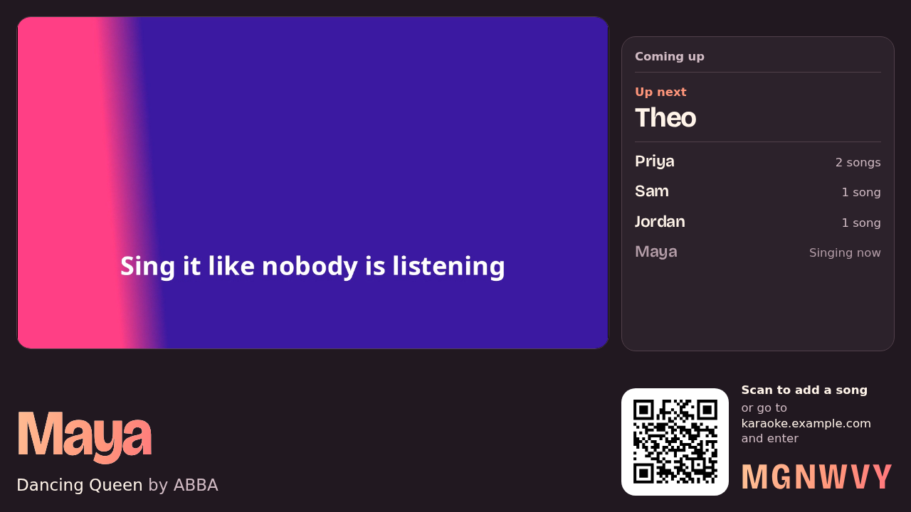
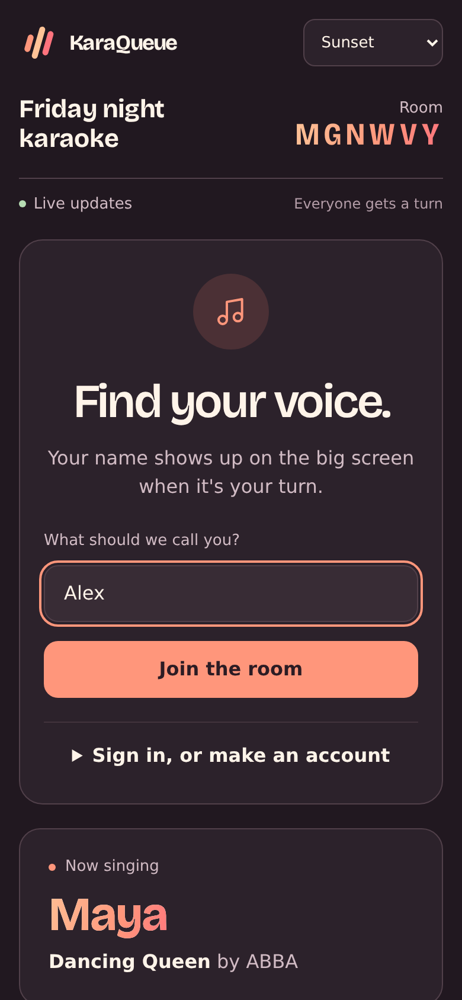
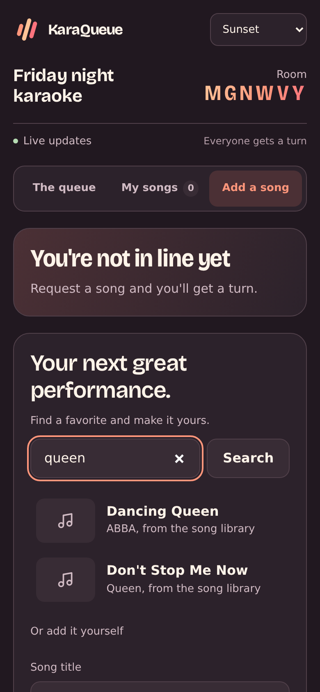
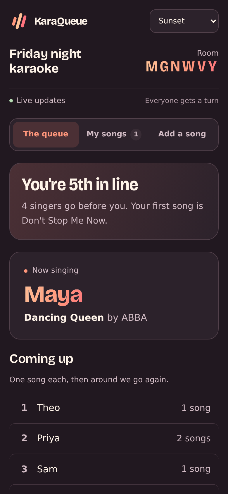
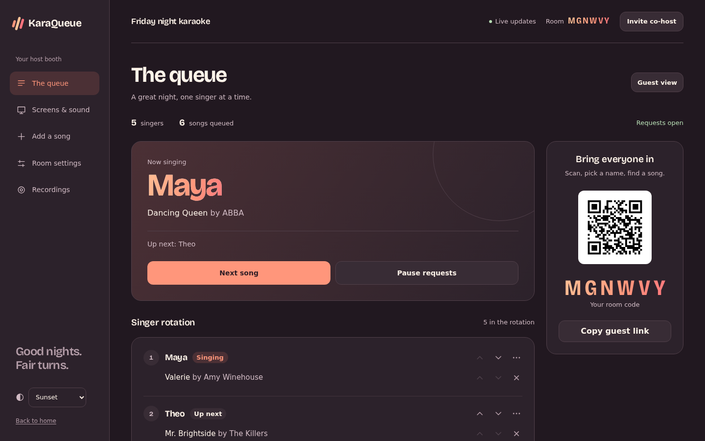
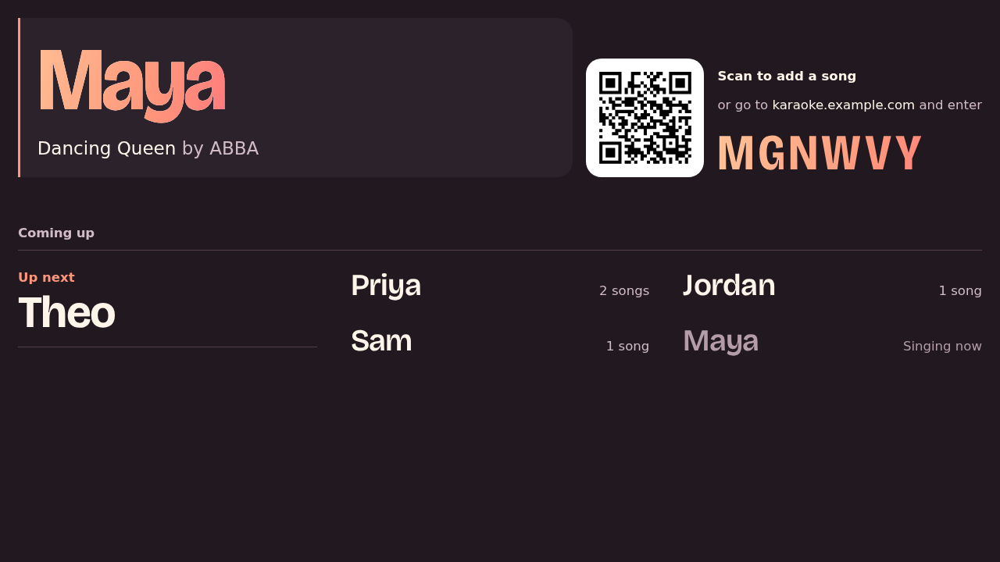

<p align="center">
  
</p>

<h1 align="center">KaraQueue</h1>

<p align="center">
  <b>A karaoke queue for parties.</b><br>
  Phones join with a QR code, the TV shows who's up, and everyone sings once before anyone sings twice.
</p>

<p align="center">
  <a href="#quick-start">Quick start</a> ·
  <a href="#desktop-app">Desktop app</a> ·
  <a href="#what-a-night-looks-like">Features</a> ·
  <a href="docs/install.md">Install guide</a> ·
  <a href="docs/configuration.md">Configuration</a> ·
  <a href="#docs">Docs</a>
</p>

<p align="center">
  <a href="https://github.com/mdbook/karaqueue/actions/workflows/test.yml"></a>
  <a href="LICENSE"></a>
  
  
</p>



No app to install, no accounts needed for guests, no karaoke-machine subscription. It runs on your own server, plays your own song library (or YouTube), and when the Wi-Fi drops for a moment, phones and screens reconnect on their own.

## Quick start

Just want it on your laptop for tonight? Grab the [desktop app](#desktop-app) instead: no Docker, no terminal. For a server that stays on, use Docker:

You need [Docker with the Compose v2 plugin](https://docs.docker.com/compose/install/) and [Git](https://git-scm.com/downloads). Docker includes ffmpeg for conversions and yt-dlp for YouTube downloads. The Compose setup builds from source, so allow a few minutes for the first start. This repo does not yet publish a public image for a clone-free install.

1. Get the files:

   ```bash
   git clone https://github.com/mdbook/karaqueue
   cd karaqueue
   cp .env.example .env
   mkdir songs
   ```

2. Open `.env` in a text editor. Uncomment or add this line, replacing the example with your own password (at least 8 characters):

   ```dotenv
   KARAQUEUE_ADMIN_PASSWORD=replace-with-your-own-password
   ```

3. Start it:

   ```bash
   docker compose up -d
   ```

4. Open [localhost:8000](http://localhost:8000), choose **Host a night**, leave the name empty and sign in with your admin password. Start a room, then open its screen link on the TV. From another device, use this computer's network address instead of `localhost`, such as `http://192.168.1.10:8000`.

## Desktop app

KaraQueue also comes as an app for Windows, macOS (Apple silicon) and Linux, in a window of its own, with YouTube support and a one-click public tunnel built in.

1. Download it from the [latest release](https://github.com/mdbook/karaqueue/releases/latest): `KaraQueue-Setup-windows-x64.exe`, `KaraQueue-macos-arm64.dmg` or `KaraQueue-linux-x64.tar.gz`.
2. Open it. It isn't signed yet, so the first time, click **More info**, then **Run anyway** on Windows, or right-click it and choose **Open** on a Mac.
3. Click **Pick a password** on the dashboard, then **Host a night**. Turn on **Public tunnel** to let guests join from anywhere, with a QR code that follows it.

The [desktop app guide](docs/desktop.md) covers each system, where your data lives, and building it yourself.

## Configuration

Put karaoke files in `songs`, or leave it empty to start with YouTube. Compose keeps the database, downloads and recordings in the `karaqueue-data` volume. Settings go in `.env`; after changing it, run `docker compose up -d` again. Most settings can also be changed at [/admin](http://localhost:8000/admin) without restarting. See the [configuration reference](docs/configuration.md) for every setting and [installation guide](docs/install.md) for backups and updates.

Prefer Python? You need Python 3.9+, ffmpeg for conversions, and yt-dlp with a JavaScript runtime for YouTube downloads. Follow the [Python setup](docs/install.md#python).

For guests outside your network, use https and set `KARAQUEUE_PUBLIC_URL`, see [Behind a reverse proxy](docs/install.md#behind-a-reverse-proxy). For a free dynamic DNS name or router port forwarding, see [Public access](docs/public-access.md).

## What a night looks like

**Guests scan and sing.** They pick a name, search for a song, and they're in line. Their phone shows where they are ("You're 5th in line"), what they've queued, and when they're up. They can reorder or drop their own songs any time.

<p>
  
  
  
</p>

**The host runs the booth.** Next song, pause requests, move singers around, skip someone who stepped out, add a song for the friend whose phone died. Bring in a co-host with one link so you get to sing too.



**Any browser is a screen.** A smart TV, a laptop on a projector, an old tablet at the bar. Each one can show the video, the line-up, a giant join code, or a singer monitor, and the host controls them all from one panel: layout, volume, which speakers, mic and reverb, and recording. Cast to a Chromecast or throw one onto a second monitor straight from the panel.



**Your songs, or YouTube's.** Point it at a folder of karaoke files (MP4, MP3+CDG, even old AVIs) and guests search it from their phone. Songs play from your server, so there are no ads and no buffering. Turn on yt-dlp and every YouTube request is downloaded before its turn comes up, and the keepers can be saved into the library for good.

**Pick a look.** Sunset, Midnight or Daylight, on any page. Each phone and TV keeps its own.

**An admin page for the boring stuff.** Every setting, live, with no restart. Rooms, library folders and naming fixes, disk space, and inviting hosts and admins by link.

## Docs

- [Installing and running](docs/install.md): Docker, Python, the first run, reverse proxies, backups
- [The desktop app](docs/desktop.md): KaraQueue as an app for Windows, macOS and Linux
- [Configuration](docs/configuration.md): every setting, in one table
- [Public access](docs/public-access.md): putting a home server on the internet with free dynamic DNS, router port forwarding, or a tunnel
- [Rooms, the rotation and hosting](docs/rooms.md): how turns work, what the host can do, getting back in on a new phone
- [Your songs](docs/library.md): the song library, fixing names, YouTube downloads and saving songs
- [Screens, sound and recordings](docs/screens.md): layouts, speakers, casting, the mic and recordings
- [Admin and accounts](docs/admin.md): the admin page, hosts and admins, guest accounts, how sign-in works
- [How it's built](docs/architecture.md): a map of the code

## Contributing

Bug reports, ideas and pull requests are welcome. [CONTRIBUTING.md](CONTRIBUTING.md) has the setup (it's a `pip install` and `pytest`), and [SECURITY.md](SECURITY.md) says how to report a security problem privately.

### Weekly container build

The existing Monday GitLab schedule resolves the latest Python dependencies and
`yt-dlp[default,deno]` on Python 3.12/Linux. It hashes the downloaded wheels and
installs with `pip --require-hashes`; other builds use the committed
`requirements.lock`. The local app is installed without dependency resolution or
build isolation, using the locked setuptools. Python's base image and Debian's
ffmpeg packages are not covered by the Python lock.

**Bootstrap needed:** this checkout has no package-index access, so the initial
lock is a fail-closed marker, not invented hashes. Run a scheduled pipeline,
review its `requirements.lock` artifact, and commit it before merging this change.
Until then, non-scheduled and local container builds deliberately fail the lock
check. Later lock refreshes follow the same review-and-commit process; CI never
pushes to git and needs no repository write credential.

Every CI image build imports the installed tools, reports their versions, and
fetches metadata for yt-dlp's small public test video with a 60-second process
timeout and no media download. Failure prevents any image push. The network smoke
is unverified locally until the first pipeline. Local Docker builds run just the
offline import/version checks unless `--build-arg EXTRACTOR_SMOKE=1` is supplied.
CI disables build caching so the smoke gate cannot reuse an old success.

The resolved lock is a non-expiring job artifact, `/app/requirements.lock` in the
image, and the full `me.mdbook.karaqueue.requirements` image label. Scheduled
images receive `latest`, UTC `YYYY-MM-DD`, short commit SHA, and branch tags;
other builds retain branch/SHA tags and `latest` on the default branch. Repeated
builds on the same day/commit overwrite those tags; date tags from previous days
remain available for rollback. CI never deletes tags. All pushes use only this
project's `CI_REGISTRY_*` credentials and `CI_REGISTRY_IMAGE`.

Infra must set masked `FLEET_ALERT_WEBHOOK` to an Apprise notification endpoint
accepting JSON `body`, and preserve dated/SHA tags in any registry cleanup policy.
Scheduled failures POST the repo and pipeline URL; an unset endpoint logs a skip.
No broader token was used in the previous CI, so none needs replacing in this file;
infra should remove any unused legacy deploy/cross-project credentials from project
variables. Keep the schedule on the default branch and confirm registry access,
outbound PyPI/YouTube access, the first smoke result, and alert delivery in CI.

## License

GPL-3.0-or-later, see [LICENSE](LICENSE).

The Bricolage Grotesque font in `karaqueue/static/fonts/` is by the Bricolage Grotesque Project Authors, under the SIL Open Font License, see [OFL.txt](karaqueue/static/fonts/OFL.txt). The screenshots use made-up guests and a generated test video.
