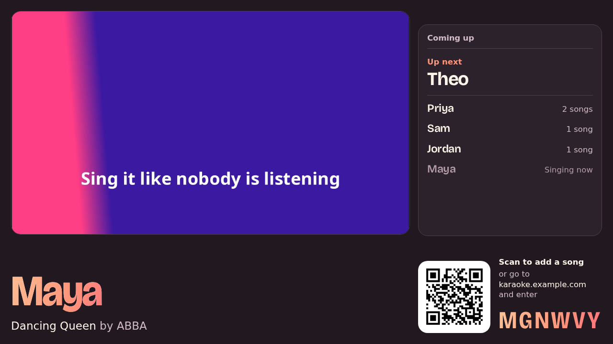
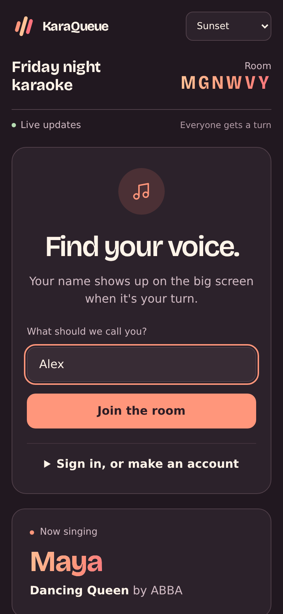
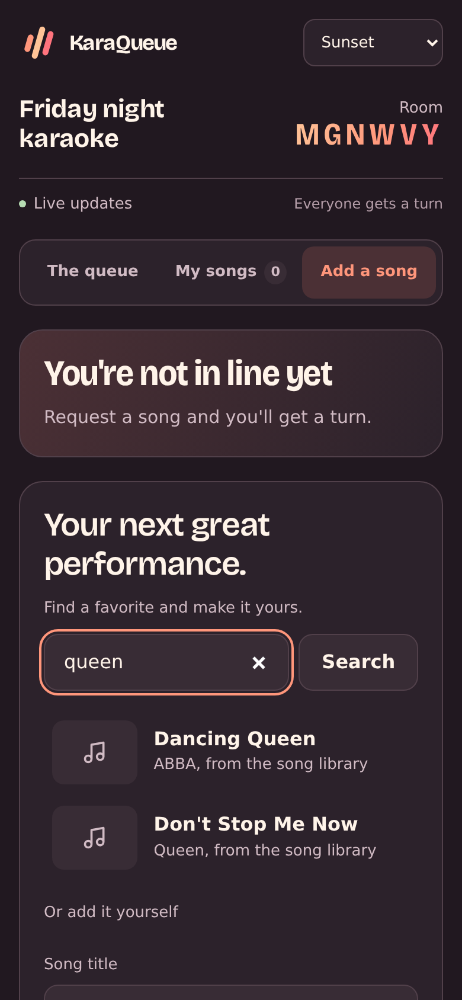
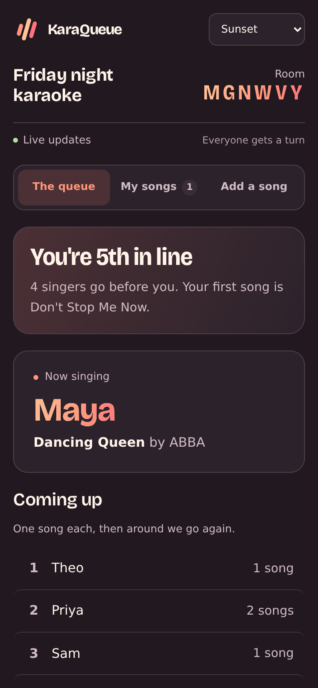
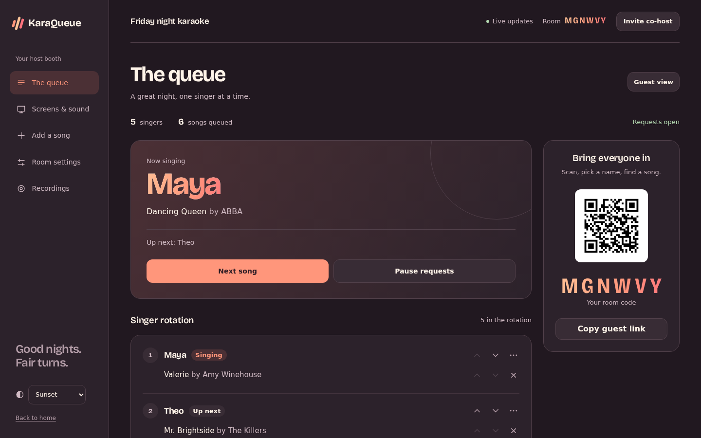

# KaraQueue

**A karaoke queue for parties.** Put the big screen up on the TV, everyone scans in with their phone, and KaraQueue keeps a fair rotation so nobody hogs the mic: everyone sings once before anyone sings twice.

No app to install, no accounts needed for guests, no karaoke-machine subscription. It runs on your own server, plays your own song library (or YouTube), and when the Wi-Fi drops for a moment, phones and screens reconnect on their own.



## What a night looks like

**Guests scan and sing.** They pick a name, search for a song, and they're in line. Their phone shows where they are ("You're 5th in line"), what they've queued, and when they're up. They can reorder or drop their own songs any time.

<p>
  
  
  
</p>

**The host runs the booth.** Next song, pause requests, move singers around, skip someone who stepped out, add a song for the friend whose phone died. Bring in a co-host with one link so you get to sing too.



**Any browser is a screen.** A smart TV, a laptop on a projector, an old tablet at the bar. Each one can show the video, the line-up, a giant join code, or a singer monitor, and the host controls them all from one panel: layout, volume, which speakers, mic and reverb, and recording. Cast to a Chromecast or throw one onto a second monitor straight from the panel.


**Your songs, or YouTube's.** Point it at a folder of karaoke files (MP4, MP3+CDG, even old AVIs) and guests search it from their phone. Songs play from your server, so there are no ads and no buffering. Turn on yt-dlp and every YouTube request is downloaded before its turn comes up, and the keepers can be saved into the library for good.

**Pick a look.** Sunset, Midnight or Daylight, on any page. Each phone and TV keeps its own.

**An admin page for the boring stuff.** Every setting, live, with no restart. Rooms, library folders and naming fixes, disk space, and inviting hosts and admins by link.

## Quick start

With Docker Compose:

```bash
git clone https://github.com/mdbook/karaqueue
cd karaqueue
cp .env.example .env
mkdir songs        # put your karaoke files here, or leave it empty
docker compose up -d
```

Then pick an admin password with the one-time setup link the server wrote: `docker compose exec karaqueue cat /data/admin-setup-link.txt` prints it (it starts at `/admin#setup=`, so open it as `http://localhost:8000/admin#setup=...`). Or skip the link and set `KARAQUEUE_ADMIN_PASSWORD` in `.env`. Then go back to the home page and start a room.

Or straight from Python 3.9+:

```bash
pip install .
KARAQUEUE_ADMIN_PASSWORD=pick-something karaqueue
```

Throwing a party for people outside your home network? Put it behind a reverse proxy with https and set `KARAQUEUE_PUBLIC_URL`, see [Behind a reverse proxy](docs/install.md#behind-a-reverse-proxy).

## Docs

- [Installing and running](docs/install.md): Docker, Python, the first run, reverse proxies, backups
- [Configuration](docs/configuration.md): every setting, in one table
- [Rooms, the rotation and hosting](docs/rooms.md): how turns work, what the host can do, getting back in on a new phone
- [Your songs](docs/library.md): the song library, fixing names, YouTube downloads and saving songs
- [Screens, sound and recordings](docs/screens.md): layouts, speakers, casting, the mic and recordings
- [Admin and accounts](docs/admin.md): the admin page, hosts and admins, guest accounts, how sign-in works
- [How it's built](docs/architecture.md): a map of the code

## Contributing

Bug reports, ideas and pull requests are welcome. [CONTRIBUTING.md](CONTRIBUTING.md) has the setup (it's a `pip install` and `pytest`), and [SECURITY.md](SECURITY.md) says how to report a security problem privately.

## License

GPL-3.0-or-later, see [LICENSE](LICENSE).

The Bricolage Grotesque font in `karaqueue/static/fonts/` is by the Bricolage Grotesque Project Authors, under the SIL Open Font License, see [OFL.txt](karaqueue/static/fonts/OFL.txt). The screenshots use made-up guests and a generated test video.
