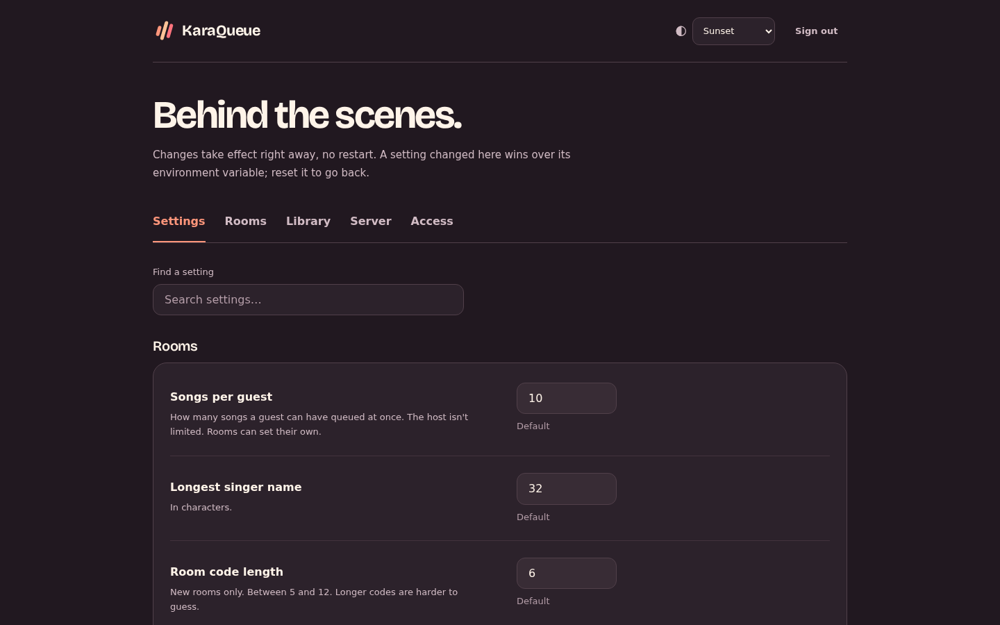

# Admin and accounts

`/admin` is for whoever runs the server. It has every setting from [Configuration](configuration.md), grouped, with where each value comes from (set here, the environment, or the default). Changes take effect right away. It also lists every room with how busy it is, and lets you delete one. The Library tab shows how much space the song folders, downloaded songs and recordings take and what's left on each disk; there you add or remove library folders, rescan, set how each folder's files are named, search every song to fix names one at a time or many at once, or delete songs, and delete downloaded songs one at a time or all at once.

The easy way to set the admin password is `KARAQUEUE_ADMIN_PASSWORD`. Without it, the server writes a one-time setup link to `admin-setup-link.txt` next to its database, readable only by the server's own user. It never prints the link itself, since logs often end up where other people can read them. Open the link and pick a password; the file goes away once you have. With Docker:

```
docker exec karaqueue cat /data/admin-setup-link.txt
```

Hosts never need the admin page: their room's rules are in the host panel.

Two things on the admin page are limited on purpose, so that whoever gets into it still can't take over the server. The yt-dlp command is set by `KARAQUEUE_YTDLP` only. And library, saved-songs, downloads and recordings folders have to be inside `KARAQUEUE_ALLOWED_FOLDERS`; without it, inside the folders the environment already sets. So with `KARAQUEUE_MEDIA_DIR=/media`, the admin page can add `/media/Rock` but not `/etc`.



## Accounts

The admin password is all you need on your own. To share the job, invite people under Access: pick Host or Admin and Make a link, then send them the link. They open it, pick their own name and password, and they're signed in. It works once, for a week, and you can cancel it until then. (You can also add an account and type its password yourself.) Each account has a name, a password and a role:

- **Admin** signs in to the admin page with their name and password, and can do everything the admin password can.
- **Host** can start rooms. Out of the box only account holders can, so the home page asks for a name and password before it makes a room (the admin password works too, with the name left empty). Set **Who can start rooms** (under Settings) to anyone, or start the server with `KARAQUEUE_NEW_ROOMS=anyone`, and hosts don't need to sign in at all, which is fine on a home network nobody else can reach.

Everyone is in one list under People: admins, hosts and guest accounts, with a search box for a busy server. From it you can change someone's role, send a Password link for a forgotten password (it works once, for a day, and signs them out everywhere else), set a password yourself, turn an account off (it's signed out at once and can't sign back in until you turn it on) or delete it. Open someone's sign-ins to see each phone or computer they're signed in on and when it was last used, and sign out one or all of them. You can't demote, turn off or delete your own account, so there's always a way back in. The admin password keeps working alongside accounts: leave the name empty when you sign in. Its sign-ins show in the list as Admin password, and changing it signs out everyone using the old one.

**Guest accounts** are in the same list. Guests make their own from the join page, with a name and a password and no email, and an account gets them back to their spot from any phone, in any room. Since there's no email, a guest who forgets their password asks an admin, who can set a new one, turn the account off or delete it. Changing the password, turning one off, or signing it out everywhere signs it out on every phone, in every room. Deleting one leaves its singers in their rooms. A guest who joined before making an account can tap Tie this spot to an account, at the bottom of their page on that same phone, and sign in or make one there.

## How sign-in works

Guests don't need passwords, and hosts only need one when the server asks hosts to sign in (see [Accounts](#accounts)). Creating a room gives your browser a host key, and joining gives it a singer key. Keys are random, the server only stores a hash of them, and they live in your browser's local storage. Clearing your browser data signs you out of that room, but you can get back in: Use another phone on your own page, or Sign in their phone in the host's menu for each singer, shows a QR code that signs a phone in as that singer. It works once, for 10 minutes, a new one replaces the last, and the code travels after the `#` in the link, so it never shows up in a proxy's logs. One singer can be signed in on 5 phones at once; a sixth signs the oldest out. A guest account does the same thing without the host: sign in and Join as yourself, and you're back on your spot. Guest account passwords are stored as salted scrypt hashes and their sign-ins are saved, so they survive a restart, for up to 180 days. The admin password and account passwords are stored as salted scrypt hashes. Admin and host sign-ins are saved too, so a restart doesn't sign anyone out, and they end after 30 days without use; one account can be signed in on 10 devices at once. Starting the server with a new `KARAQUEUE_ADMIN_PASSWORD` signs out everyone using the old one. Invite and password links are random, stored only as a hash, travel after the `#` like the QR codes, and work once.

After 10 wrong passwords from one address, or 50 for one account name, sign-in says to try again later for 15 minutes. Guest accounts count on their own, since a whole party shares the venue's wifi: 10 wrong tries locks that one account name, and it takes 100 from one address (scaled by the Rate limits setting) to lock the address. Guest typos never lock out the admin. Every page comes with a Content-Security-Policy and the other usual security headers, so nothing but KaraQueue's own scripts and YouTube's player can run on it and other sites can't frame it; over https it also sends HSTS. Requests bigger than 64 KB are refused, apart from recording uploads, which have their own limit, and the `karaqueue` command caps socket messages at 16 KB.

