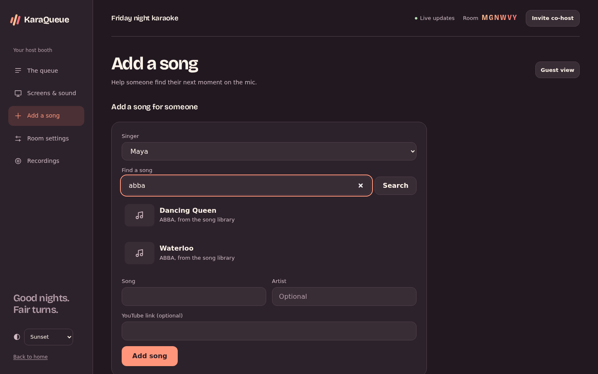

# Your songs: the library and YouTube

Got a folder of karaoke videos? Set `KARAQUEUE_MEDIA_DIR` to it and guests can search it from the request form. Songs play straight from your server, so the party keeps going with no internet at all.

KaraQueue reads the song and artist from file names shaped like `Artist - Song.mp4`, and ignores disc codes (`SC8123-05 - Artist - Song.mp4`) and tags like `(Karaoke Version)`. Subfolders are fine. New files show up within a minute.

What it plays:

| Files | How |
| --- | --- |
| MP4, M4V, WebM, MP3, M4A, OGG, WAV, FLAC | Straight to the browser. MKV and MOV work in most browsers too. |
| MP3+CDG pairs (`Song.mp3` next to `Song.cdg`, any audio type), or both zipped together | The screen draws the CD+G lyrics itself, in time with the music. |
| AVI, MPG, WMV, FLV, VOB, TS, 3GP, DivX, ASF, M2TS | Converted to MP4 on the fly while it plays, if ffmpeg is installed. Skipping around in these doesn't work, and converting HD video takes a fair bit of CPU, so only `KARAQUEUE_CONVERSIONS` of them convert at once. |

With Docker, mount the folder read-only:

```bash
docker run -p 8000:8000 -v karaqueue-data:/data -v /path/to/karaoke:/media:ro -e KARAQUEUE_MEDIA_DIR=/media karaqueue
```

More than one folder? Separate them with `:` (`;` on Windows), or add them on the admin page's Library tab. That tab also shows every song with its size, lets you fix a title or artist the file name got wrong (the fix is kept in the database, so the file stays as it is), and deletes songs you don't want. Deleting needs the folder to be writable, so skip `:ro` on the mount if you want that.



## Fixing names

Files named some other way? Each folder on the Library tab has a Naming button. Write how its files are named, like `{title} - {artist}`, and KaraQueue shows how many songs fit and what they'd be called before you save. `{skip}` leaves a part out, like a track number, and `/` steps into the folder above, so `{artist}/{title}` reads `ABBA/Waterloo.mp3` and `{artist}/{skip} - {title}` reads `ABBA/01 - Waterloo.mp3`. Files the pattern doesn't fit keep the name KaraQueue guesses for them.

For the odd ones out, tick songs in the list and fix them together: give them all one artist, swap title and artist, or undo your fixes. When you edit one song, Look up asks [MusicBrainz](https://musicbrainz.org) for its real title and artist; pick one to fill them in. Fixes made by hand always win over a folder's naming, and none of this renames a file.

Songs only play from a link the room hands its screens for the song that's on. Each link works for one room and runs out after a few hours, so a room code doesn't open up the whole library. Downloaded YouTube songs work the same way.

## Downloading YouTube songs

Install [yt-dlp](https://github.com/yt-dlp/yt-dlp) with a JavaScript runtime (`pip install "yt-dlp[default,deno]"`) and ffmpeg, so it can join HD video and audio, then set `KARAQUEUE_DOWNLOADS_DIR`. The Docker image already has all of it. YouTube breaks old yt-dlp versions every so often, so if downloads stop working, update yt-dlp (or pull a fresh image). Then:

- Every YouTube song gets downloaded to the server the moment it's requested. By the time it comes up it plays from disk, so it can go to any speaker, gets recorded with its music, has no ads, and keeps playing if the internet drops. If a song comes up before it's done, the screen says it's getting the song ready and starts it the moment the file lands. Lots of karaoke channels don't let their videos play outside youtube.com, so with downloads on the screen never uses YouTube's player, unless the download itself fails.
- Guests can search YouTube from the request form without an API key. The server runs two searches at a time and remembers answers for 15 minutes, since a party tends to search the same songs.
- Each room downloads at most `KARAQUEUE_DOWNLOADS_PER_HOUR` new songs an hour, so one room can't flood the downloads folder or get your server's address blocked by YouTube. Songs already on the server don't count, guests can still queue songs past it, and the song that's on always downloads.

## Saving songs into the library

The downloads folder is a cache: it trims the songs played longest ago. To keep a song for good, save it into the library. With yt-dlp installed and a library folder set up, the admin page's Library tab and the host page's Add a song view both get a Save songs box: search YouTube or paste a link, check the title and artist, and Save. Songs download one at a time, show up in the library a moment later, and from then on guests find them in library search like any other song, with no internet needed.

Saved songs are named `Artist - Title [video id].mp4`, so the library reads the names right and saving the same video twice just finds the first. They go into a `YouTube` folder inside your first library folder, or into `KARAQUEUE_SAVE_DIR` if you set it (handy when the library is mounted read-only); that folder joins the library by itself. A song already in the downloads folder is copied over instead of downloaded again. Each room's host can save `KARAQUEUE_SAVES_PER_HOUR` new songs an hour (10 by default; admins aren't limited), and set `KARAQUEUE_WHO_SAVES=admins` if only admins should save. Songs bigger than `KARAQUEUE_SAVE_MAX_MB` (500 by default) aren't saved, at most 20 saves wait their turn at once, and saving stops while the disk has less than 1 GB free, checked before and after each download. A save that fails cleans up after itself; the host sees a short reason and the details go to the server log.

Only YouTube links get downloaded. KaraQueue builds the address itself from the video id, so nobody can point your server at some other site.

