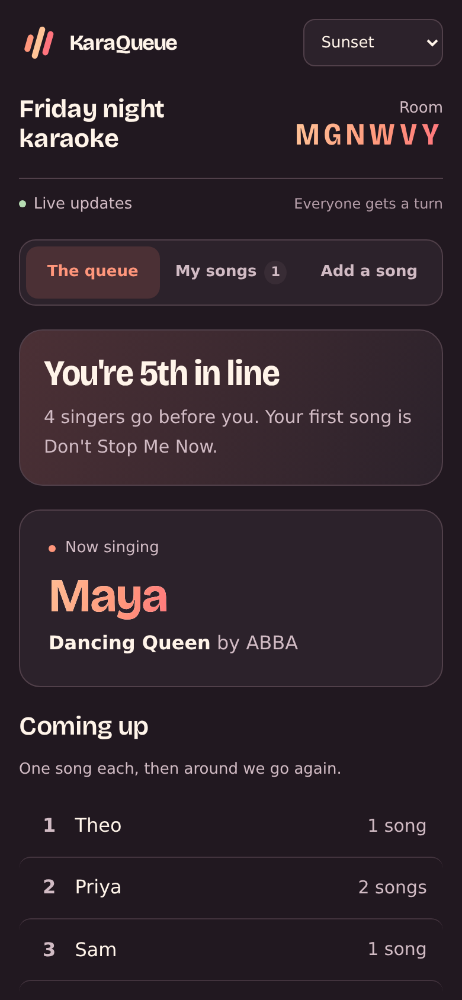

# Rooms, the rotation and hosting

## Rooms

A room is one party. The host starts it from the home page (Host a night), gives it a name, and gets a short code like `K7QM2X`. One server can run as many rooms as you want at once, and each has its own guests, songs, screens and rules. A room nobody has touched in `KARAQUEUE_ROOM_DAYS` days (30 by default) gets deleted, unless a phone or screen still has it open.

Guests join by scanning the QR code on the big screen or the host page, or by going to the server and typing the code. They pick a name and they're in. No account, no app.

## How the rotation works

KaraQueue keeps a list of singers in order, and each singer keeps their own list of songs. When a song ends (or the host presses Next song), the next singer after whoever just sang gets their turn, and they sing the first song on their own list.

That gives you a few nice properties without anyone having to referee:

- **Everyone sings once before anyone sings twice.** Queuing ten songs doesn't get you ten turns in a row, it just means you're never out of ideas.
- **Late arrivals join at the back of the line.** Someone who shows up at midnight waits their turn like everyone else.
- **An empty list skips you, not the party.** Singers with nothing queued are passed over until they add something, and keep their spot.
- **You control your own setlist.** Guests reorder or remove their songs from their phone any time before they come up.

Guests see where they are on their phone ("You're 5th in line") and the big screen shows who's up next.

## What the host can do

The host page (`/r/<code>/host`) is the control booth:

- **The queue.** Next song, pause requests (guests can still look, they just can't add), and the whole rotation. Move singers earlier or later, skip someone for now (they keep their spot and songs, and come back when you put them back in), or remove them, their songs and their recordings.
- **Add a song for someone.** Search the library or YouTube for a guest and add it to their list, or add a guest by hand for someone without a phone. The host isn't held to the song limit.
- **Screens & sound.** Every TV, what it shows, where the sound comes from, the mic and recording. See [Screens](screens.md).
- **Room settings.** How many songs each guest can queue, whether guests can use YouTube, the song library, or both, and a pause between songs (0 to 60 seconds): when a song ends, the screens count down "Name is up in 5" before the next song starts. Pressing Next skips the countdown.
- **Recordings.** Everyone's takes, when recording is on.
- **Invite co-host.** Shows a QR code (and a copy link) that signs another device in as host, for when you want to run the room from your phone as well, or sing too. Anyone who scans it is a host, so only show it to people you trust.

Next song asks first if someone is still mid-song, so a stray tap doesn't cut off a singer.

## Getting back in

Phones die, browsers get cleared, people switch to a friend's phone. A guest can get their spot and songs back a few ways:

- **From another phone they're signed in on:** Use another phone, at the bottom of their page, shows a QR code that signs the new phone in as them.
- **From the host:** the menu next to each singer has Sign in their phone, which shows the same kind of code. It works once, for 10 minutes.
- **With a guest account:** guests can make one from the join page with just a name and a password (no email). It works in every room on the server, so signing in and pressing Join as (their name) puts them right back on their spot. A guest who joined first can tie their spot to an account later, from the bottom of their page.

One singer can be signed in on 5 phones at once. A sixth signs the oldest out.

## Your rooms on the home page

The home page has a Your rooms section under the big headline, with two columns: Hosting and Joined. Each room shows its code, who's singing (or when it was last used), and in rooms you joined, your place in line. Live rooms come first. Tap a room to go straight back to the host page or your spot. Each column shows 4 rooms, with Show more for the rest. When you have none yet, the section says so and explains what will show up there.

Where the list comes from is written at the top of each column:

- **On this browser:** every room this browser started or joined keeps its key in the browser, and the list is made from those. Nothing is sent anywhere to build it. Forget takes a room off the list and drops its key from this browser, which signs this browser out of it.
- **On your account:** signed in as a host (or with [SSO](admin.md#sign-in-with-oidc)), Hosting lists the rooms your account started, on any phone or computer. Opening one from a device that didn't start it gives that device its own host key, which lasts only as long as you're signed in there. Signing out on that device stops it hosting the room. So does anything else that ends the sign-in: signing out everywhere, a new password, or an admin turning off or deleting your account. Sign in again and open the room to host it from there once more. The device that started the room keeps its own key, signed in or not. Signed in with a guest account, Joined lists the rooms that account is in. Other accounts never see your rooms.

A room that's been deleted, because nobody touched it for `KARAQUEUE_ROOM_DAYS` days or an admin removed it, moves into a closed rooms group at the bottom of the column. Forget closed rooms clears them out. Rooms started before your server had this, or with the built-in admin password, aren't on any account; they still show from the browser that started them.
