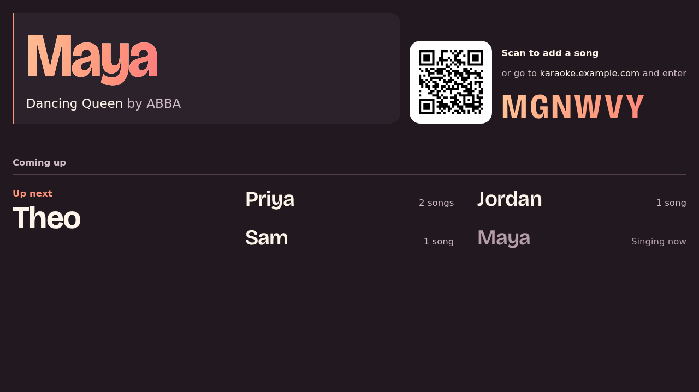
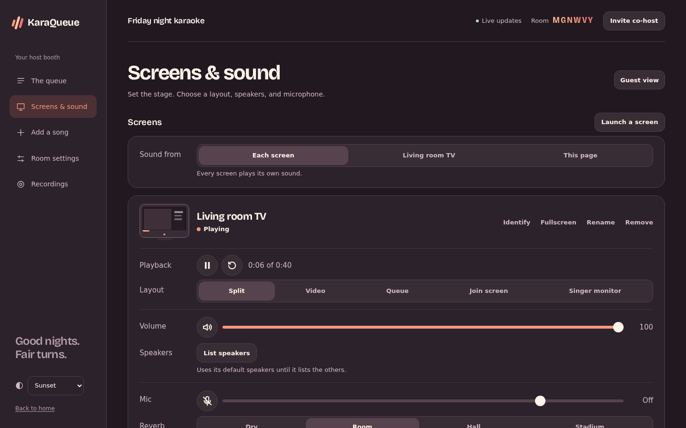

# Screens, sound and recordings

Any browser can be a screen: a smart TV, a laptop plugged into a projector, an old tablet on the bar. Open `/r/<code>/screen` on it and tap once to turn on sound. The first time, it shows a six-digit code and asks to join: the host lets it in under Screens, by that code, and from then on it comes straight back, even after a restart. Screens opened from the host's own browser (Launch a screen, the other monitor, Chromecast) join by themselves. Until it's let in, a screen can't be controlled, can't steer the other screens and can't save recordings, so knowing the room code isn't enough to take over the TV. Remove a screen from the panel and it has to ask again. A screen asking to join never pushes out one that's already waiting: past a dozen waiting, or two from one address, new ones are refused and try again a minute later. Add `?name=Living room` to the address to name it up front, or rename it from the panel.

Each screen can show one of these:

| Layout | What it's for |
| --- | --- |
| Split | The video, who's singing, the singer order and the join code. A good default. |
| Video | Just the video, with a small note of who's singing and who's next. |
| Queue | No video. Who's singing and the singer order, big enough to read across the room. |
| Join screen | A giant QR code and room code, for the start of the night. |
| Singer monitor | The video as big as it gets, plus who's up next. Point it at the singer. |

Screens remember their name and settings, so a TV that reloads or loses Wi-Fi comes back the way you left it. Browsers only allow fullscreen and sound after someone touches the screen once, so the first tap on a new screen does both.

Screens move on to the next song by themselves when a video ends, whether they were opened from the host's browser or let in by their code. With several screens in a room, the show still moves on only once.

## Speakers, second monitors and casting

- **Sound from.** By default every screen plays its own sound. Under Sound from in Screens & sound, the host can pick one screen, or This page, to be the only one with sound. The music, the mic and recording all happen there, and every other screen plays muted with its picture kept in step. This page means the computer running the host panel: handy when the speakers and the mic are plugged into the laptop and the TV is across the room on a Chromecast. Switch any time, even mid-song. If the screen with the sound closes, the others start playing their own sound again after a few seconds.
- **Speakers.** Each screen in the host panel gets a speaker picker, so the laptop on the projector can play through the soundbar instead of its own tinny speakers. The first time, press List speakers and tap the screen: browsers only show a page its speakers after it's been allowed the microphone. Nothing gets recorded. This works for songs from your own library; YouTube songs always play through the default speakers, since the page can't reroute YouTube's player.
- **Second monitor.** If the host's computer has two monitors, Open on the other monitor puts a screen right on the second one. Press F there to fill it.
- **Chromecast.** When the host's browser can see a Chromecast or other cast display, a Cast a screen button shows up. The cast page is just another screen and appears in the list like any TV.

These need Chrome or Edge, with the page opened over https or on `localhost`. Over plain http on your network the buttons stay hidden and screens use their default speakers. Putting KaraQueue behind a reverse proxy with a certificate (Caddy does this in a couple of lines) turns them on everywhere; see [Behind a reverse proxy](install.md#behind-a-reverse-proxy).

## Mic and recordings

- **Mic.** Plug a USB mic or an audio interface into the computer running a screen, then switch Mic on for that screen in the host panel. The singer comes out of the screen's speakers, with a reverb you pick: dry, a room, a hall or a stadium. Browsers only hand a page the mic over https or on `localhost`, same as the speaker picker.
- **Recordings.** Set `KARAQUEUE_RECORDINGS_DIR` and a Record switch shows up next to each screen's mic. While it's on, the screen records every performance (the voice with its reverb, plus the music for songs from your library) and saves it to the server when the song ends or the host moves on. Each singer finds their takes under Your recordings on their phone and can save or delete them; the host sees everyone's. YouTube songs record the voice only, since the page can't hear YouTube's player. Takes under five seconds are skipped. Only the host turns recording on, each screen saves each song once, and only the song that just played. A room stops saving at `KARAQUEUE_RECORDINGS_ROOM_MB`, the whole server at `KARAQUEUE_RECORDINGS_MAX_GB`, and recordings never take the disk's last gigabyte. If the server has ffmpeg (the Docker image does), it tidies each take as it arrives so you can skip around in it.

